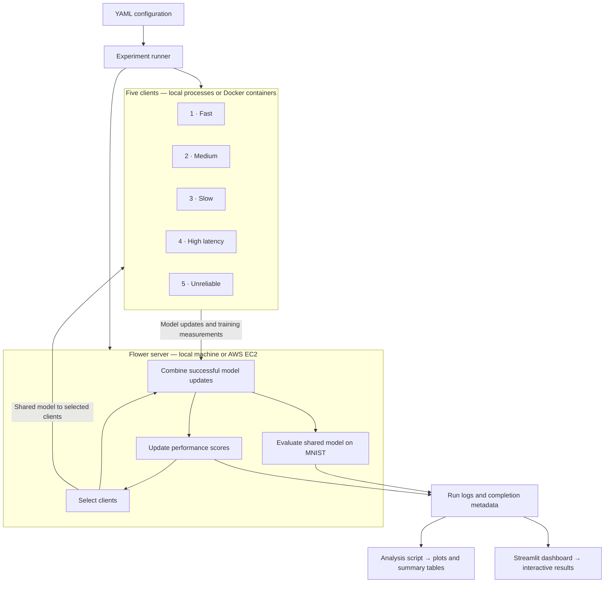

# CloudCraft

### Performance-aware federated learning

CloudCraft trains a shared machine-learning model across **five simulated clients**, each with its own portion of the MNIST handwritten-digit dataset. Some clients are fast, some are slow, and some have unreliable connections.

Instead of asking every client to train in every round, CloudCraft measures their performance and chooses which clients should participate next. The goal is to reach good model accuracy sooner while giving slower clients opportunities to contribute.

**Team:** Kinjal Nandi and Sri Saidhakshini V

[Getting started](#getting-started) · [System architecture](#system-architecture) · [Run experiments](#run-experiments) · [View results](#view-results) · [Detailed report](REPORT.md)

## How it works

In federated learning, each client trains on its own data and sends model updates to a central server. The server combines those updates into one shared model. This project uses **Flower** to coordinate training and **PyTorch** to train a small image classifier.

CloudCraft adds a selection step:

1. **Observe:** ask all five clients to train during the first two rounds.
2. **Score:** measure training time, communication overhead and successful responses.
3. **Select:** choose the three highest-scoring clients for the next round.
4. **Explore:** in the exploration variant, occasionally swap in another client so lower-ranked clients can contribute again.
5. **Repeat:** combine successful updates, evaluate the model and record the results.

The number of selected clients is called **K**. By default, K = 3. Exploration makes participation possible; it does not guarantee every client is selected again within a short run.

## System architecture



Each client uses its own saved data partition. The server records request duration and failures, and uses client-reported training time to estimate communication overhead. The runner automates the runs; the analysis tools help compare their results.

## Getting started

### 1. Set up Python

Run these commands from the repository root. The project declares **Python 3.13** and pinned dependencies in `requirements.txt`. The current pinned environment still needs installation and integration validation; see [project status](#project-status).

**Windows PowerShell**

```powershell
python -m venv .venv
.\.venv\Scripts\Activate.ps1
```

**Linux / macOS**

```bash
python -m venv .venv
source .venv/bin/activate
```

Then install the dependencies and run the scorer tests:

```bash
python -m pip install -r requirements.txt --extra-index-url https://download.pytorch.org/whl/cpu
python -m pytest tests
```

The local workflow uses Python processes, so Docker and an AWS account are only needed for the container/cloud workflow.

### 2. Run one local baseline

```bash
python -m cloudcraft.runner --config configs/base.yaml --conditions A --splits iid --seeds 0
```

This starts a server and five clients on your machine, prepares the data, and runs **20 training rounds** with all clients participating. The first run downloads MNIST and needs internet access. Runtime depends on your machine and simulated delays; this is a baseline run rather than a quick smoke test.

Results are saved under `results/A_iid_seed0/`.

### 3. Open the results dashboard

```bash
streamlit run analysis/dashboard.py
```

Open the address printed by Streamlit. In the sidebar, set **Results folder** to `results`—the dashboard initially uses `results_full2`.

The dashboard shows accuracy, round duration, client selection and run completion. Its cloud controls are useful when you move to EC2; local results can be viewed directly.

## Run experiments

CloudCraft compares four ways to select clients:

| Condition | Selection method | Question it answers |
| --- | --- | --- |
| **A — Full FedAvg** | All five clients every round | How does full participation perform? |
| **B — Random** | Three randomly chosen clients every round | Does selecting fewer clients help on its own? |
| **C — Performance-aware** | All five for two warm-up rounds, then the best three by score | Does performance-based selection help? |
| **D — Performance + exploration** | C, with occasional swaps to include other clients | What is the cost and benefit of broader participation? |

Try one performance-aware run:

```bash
python -m cloudcraft.runner --config configs/base.yaml --conditions D --splits iid --seeds 0
```

Run the complete comparison:

```bash
python -m cloudcraft.runner --config configs/experiment.yaml
```

This performs **24 runs**, each with **30 rounds**: four conditions × two data splits × three random seeds. An **IID** split distributes data similarly across clients; a **Dirichlet** split gives clients different data distributions. Repeating seeds helps measure variation.

To continue a sweep while skipping completed runs:

```bash
python -m cloudcraft.runner --config configs/experiment.yaml --resume
```

Without `--resume`, the runner executes the requested runs again.

## View results

For interactive exploration, use the dashboard described above. For saved charts and tables, run:

```bash
python analysis/analyze.py --results results --out analysis/output --target 0.97
```

Analysis needs at least one completed run. It produces:

| Output | What to look for |
| --- | --- |
| `summary_table.csv` / `summary_table.md` | Accuracy, timing and coverage, summarized across seeds |
| `per_run_metrics.csv` | Metrics for each individual run |
| `accuracy_vs_time.png` | How quickly each method improves accuracy |
| `round_time.png` | How long training rounds take |
| `selection_heatmap_*.png` | How often each client is chosen in C and D |

Raw files are organized like this:

```text
results/
└── A_iid_seed0/
    ├── log.csv       # One row per client per round
    ├── meta.json     # Expected rows, observed rows and completion flag
    ├── server.log
    └── client1.log   # Separate logs for each local client
```

**Reading the metrics:**

- **Time to target** is the first recorded round reaching 97% accuracy and staying at or above it through the final round. Runs that miss the target are excluded from the time average; always check `target_reached` too.
- **Training wall-clock time** excludes server-side evaluation, so it differs from total job runtime.
- **Client coverage** in the summary includes the two warm-up rounds. Use the dashboard's post-warm-up selection table to check whether clients keep participating.
- **Complete** means the server logged the expected row count. Analysis skips runs that are not marked complete.

For exact metric definitions and interpretation limits, see the [detailed report](REPORT.md#7-logs-and-metric-definitions).

## Configuration

Edit `configs/base.yaml` to change shared defaults. `configs/experiment.yaml` inherits those defaults and changes the full sweep to 30 rounds. Custom override files placed beside `base.yaml` are merged in the same way.

| Setting | Default | Meaning |
| --- | --- | --- |
| `training.rounds` | 20; full sweep uses 30 | Number of training rounds per run |
| `training.round_timeout` | 60 seconds | Time limit for a training round |
| `selection.k` | 3 | Number of clients selected after warm-up in C/D, and each round in B |
| `selection.warmup_rounds` | 2 | Initial all-client rounds in C and D |
| `selection.epsilon` | 0.1 | Chance of attempting an exploration swap per selected slot in D |
| `scoring.w_time` / `w_latency` / `w_reliability` | 0.3 / 0.2 / 0.5 | Importance of speed, communication overhead and reliability |
| `scoring.ema_beta` | 0.3 | How strongly new measurements affect the smoothed statistics |

The configured client profiles add these simulated conditions:

| Client | Behaviour |
| --- | --- |
| Fast | No extra delay |
| Medium | 3–5 seconds of extra training delay |
| Slow | 8–12 seconds of extra training delay |
| High-latency | 3–5 seconds of delay outside measured training time |
| Unreliable | 30% failure probability per training attempt |

The default failure mode simulates a timeout. Full scoring details, optional staleness-based exploration and measurement caveats are in the [report](REPORT.md).

## Run on AWS EC2

The cloud workflow places the Flower server on EC2 and runs the five Docker clients on your machine or a second EC2 instance. It requires Docker, SSH/SCP, an accessible `ubuntu` account and the repository on both hosts.

1. Prepare matching MNIST data and split indices on **both hosts**:

   ```bash
   python -m cloudcraft.prepare_data --config configs/experiment.yaml
   ```

2. On the **server host**, build the server image:

   ```bash
   docker build -t cloudcraft -f docker/Dockerfile .
   ```

3. On the **client host**, build the clients and start the sweep:

   ```bash
   docker compose build
   python -m cloudcraft.runner --config configs/experiment.yaml --remote-host <server-ip> --ssh-key <key.pem> --remote-dir ~/cloud-craft
   ```

Replace `<server-ip>` and `<key.pem>` with your server address and SSH key path. The remote repository path defaults to `~/cloud-craft`; use `--remote-dir` if yours differs. Allow port **8080** from the client host and SSH from authorized hosts. Stop idle EC2 instances after experiments.

The dashboard can also synchronize cloud results and control a sweep through SSH. Enter your deployment's connection details in its sidebar. Optional `NETEM_DELAY` adds container-level network delay on top of the software profile.

## Project structure

| Path | Contents |
| --- | --- |
| `cloudcraft/` | Model, data preparation, clients, server, scoring and experiment runner |
| `analysis/analyze.py` | Saved charts and metric tables |
| `analysis/dashboard.py` | Interactive results dashboard and EC2 controls |
| `configs/` | Shared settings and experiment overrides |
| `tests/test_scoring.py` | 15 scorer and selection unit tests |
| `docker/`, `docker-compose.yml` | Container setup for five clients |
| [PRD.md](PRD.md) | Requirements and acceptance targets |
| [REPORT.md](REPORT.md) | Detailed design, methodology, limitations and evaluation protocol |

## Project status

The scoring, selection, client/server code, experiment runner, Docker setup and analysis tools are implemented. Earlier documentation records passing scorer tests and a short smoke sweep on Flower 1.13.1. The current pins include Flower 1.39.0 and PyTorch 2.6.0; that environment and the cloud workflow still need validation.

This checkout contains no experiment result logs. **The proposed 30% speedup and accuracy goals are targets, not measured results.** The next steps are to validate the environment, confirm learning and timeout recovery, and collect the complete 24-run comparison. See the [report](REPORT.md) for the full evaluation checklist.
